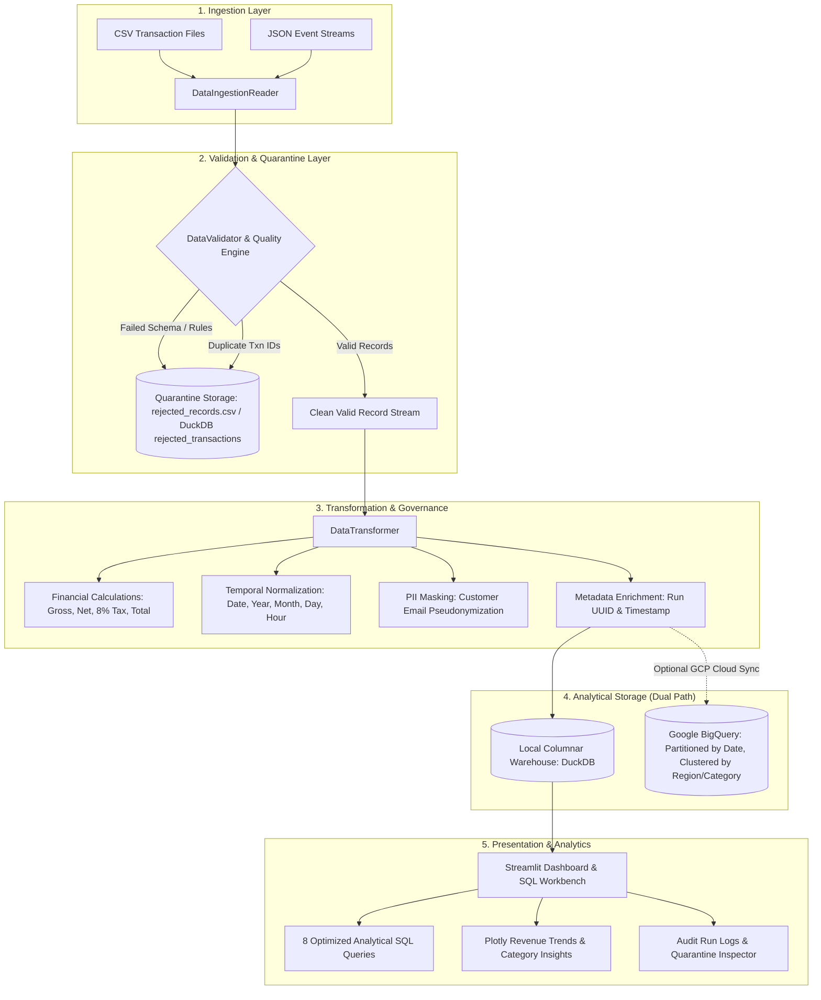

# Real-Time Retail Analytics: Cloud Data Engineering Pipeline

[](https://www.python.org/downloads/)
[](https://beam.apache.org/)
[](https://duckdb.org/)
[](https://streamlit.io/)
[](https://cloud.google.com/)
[]()
[](LICENSE)

An enterprise-grade, end-to-end data engineering ELT pipeline that ingests retail sales transactions, applies rigorous schema and business-rule validation, quarantines malformed records with explainable failure reason codes, executes financial and temporal normalizations, enforces PII protection, loads data into a high-performance analytical warehouse (DuckDB locally / Google BigQuery on cloud), and delivers interactive business intelligence via a Streamlit web application.

---

## 1. Project Overview & Business Problem

Retail enterprises process thousands of daily transactions across physical branches and e-commerce portals. Upstream transaction ingestion often encounters data corruption: missing customer identifiers, negative quantities, malformed timestamps, discount amounts exceeding gross sales, and network retry duplicate transactions.

Without a robust data quality and governance gatekeeper:
1. Dirty or duplicated rows pollute reporting dashboards and skew financial accounting.
2. Silent data corruption breaks downstream analytical queries and ML forecasting models.
3. Customer Personally Identifiable Information (PII) is exposed in open warehouse tables without masking.

This project delivers a resilient, idempotent data engineering pipeline designed with **Google Cloud Dataflow / Apache Beam** principles and **DuckDB/BigQuery OLAP** warehousing to guarantee data completeness, auditability, and analytical reliability.

---

## 2. Key Objectives

- **Automated Validation & Quarantine:** Detect missing fields, type errors, negative values, and business-rule violations, routing corrupt records to quarantine without failing the entire batch.
- **Explainable Quality Auditing:** Stamp every rejected row with a machine-readable reason code (`ERR_NON_POSITIVE_QUANTITY`, `ERR_DISCOUNT_EXCEEDS_GROSS`, `ERR_DUPLICATE_TXN_ID`).
- **Mathematical Data Quality Scoring:** Compute an explicit conformance score (0-100%) tracking Completeness, Validity, Uniqueness, and Consistency.
- **Idempotent Ingestion & Deduplication:** Safely process repeated files without producing duplicate transaction rows in the analytical warehouse.
- **Dual-Engine Architecture:** Zero-cloud-cost local execution on Windows 11 with DuckDB, coupled with native compatibility for Google Cloud Storage (GCS), Google Cloud Dataflow, and BigQuery.
- **Governance & PII Protection:** Automatic pseudonymization of customer email addresses (`j***e@domain.com`) to support GDPR/CCPA standards.
- **Interactive Analytics Dashboard:** Real-time KPI aggregation, daily/weekly revenue trends, category breakdowns, regional performance, and a live SQL workbench.

---

## 3. Architecture & Data Flow



---

## 4. Google Cloud Competency Alignment

| Competency Area | Implementation in this Project | GCP Enterprise Service |
| :--- | :--- | :--- |
| **Data Processing & ETL/ELT** | Modular pure functions in Python; batch pipeline orchestrator | **Cloud Dataflow** |
| **Distributed Pipeline Architecture** | Apache Beam pipeline (`src/pipeline/beam_pipeline.py`) with branching PTransforms | **Apache Beam on Dataflow** |
| **Analytical Data Warehousing** | Columnar DuckDB locally; BigQuery DDL schema with partitioning and clustering | **Google BigQuery** |
| **Object Ingestion** | Local filesystem / buffer ingestion; GCS input prefix configuration | **Google Cloud Storage (GCS)** |
| **Data Quality & Governance** | 4-dimension scoring, quarantine isolation, and PII email masking | **Dataplex & Cloud DLP** |
| **Idempotency & Deduplication** | Primary key deduplication and idempotent upserts | **BigQuery MERGE / Upsert** |
| **SQL Modeling** | 8 production queries (AOV, LTV, revenue velocity, regional share) | **BigQuery Standard SQL** |
| **Security & Least-Privilege** | Zero hardcoded keys, `.env.example` templates, masked PII | **Cloud IAM & Secret Manager** |

---

## 5. Technology Stack

- **Core Language:** Python 3.12+
- **Data Manipulation & OLAP:** DuckDB, Pandas, NumPy, PyArrow
- **Big Data Processing:** Apache Beam 2.77.0
- **Interactive UI & Visualization:** Streamlit, Plotly
- **Quality Assurance & Testing:** Pytest, Flake8
- **Optional Cloud Connectors:** `google-cloud-bigquery`, `google-cloud-storage`

---

## 6. Project Directory Structure

```text
Cloud-Data-Engineering-Pipeline/
├── app.py                             # Streamlit interactive analytics dashboard
├── requirements.txt                   # Production dependencies
├── pytest.ini                         # Pytest configuration
├── .gitignore                         # Git exclusion rules
├── .env.example                       # Environment variables template
├── LICENSE                            # MIT open-source license
├── README.md                          # Comprehensive documentation
├── schemas/
│   ├── retail_schema.json             # Ingestion data contract & field rules
│   └── bigquery_retail_transactions.json # BigQuery partitioned/clustered schema
├── sample_data/
│   ├── retail_transactions.csv        # 1,200 sample transactions (with known test anomalies)
│   └── retail_transactions.json       # JSON formatted equivalent
├── scripts/
│   └── generate_sample_data.py        # Reproducible sample data generator
├── sql/                               # Dedicated Analytical SQL Suite
│   ├── 01_total_revenue_summary.sql   # Revenue, order volume, and AOV
│   ├── 02_revenue_by_category.sql     # Category sales and discount rates
│   ├── 03_revenue_trends.sql          # Daily/weekly time-series trend
│   ├── 04_top_products.sql            # Best-selling SKUs by billed total
│   ├── 05_customer_summaries.sql      # Customer LTV and order frequency
│   ├── 06_regional_performance.sql    # Regional market share and basket size
│   ├── 07_duplicate_anomaly_checks.sql# Governance audit verifying uniqueness
│   └── 08_data_quality_monitoring.sql # Null-checks and quarantine breakdown
├── src/
│   ├── config.py                      # Project paths and GCP parameters
│   ├── ingestion/
│   │   └── reader.py                  # Ingestion for CSV/JSON sources and buffers
│   ├── quality/
│   │   ├── validator.py               # Validation, quarantine routing, error tags
│   │   └── governance.py              # Data Quality Score, lineage, and PII masking
│   ├── transformation/
│   │   └── transformer.py             # Pure financial arithmetic and calendar logic
│   ├── warehouse/
│   │   └── duckdb_warehouse.py        # DuckDB columnar storage and idempotent upsert
│   ├── loaders/
│   │   └── bigquery_loader.py         # BigQuery cloud adapter & offline simulation
│   └── pipeline/
│       ├── batch_pipeline.py          # High-speed batch pipeline orchestrator
│       └── beam_pipeline.py           # Production Apache Beam pipeline (Direct/Dataflow)
├── tests/
│   ├── conftest.py                    # Test configuration and path setup
│   ├── test_validation.py             # Unit tests for schema and quarantine rules
│   ├── test_transformation.py         # Unit tests for tax, financial, and PII logic
│   ├── test_pipeline.py               # Integration tests for warehouse loading
│   └── test_sql.py                    # Verification tests for all 8 SQL queries
└── warehouse/                         # Local database and export snapshots
    ├── retail_analytics.duckdb        # Persistent DuckDB columnar database
    ├── clean_transactions.parquet     # Parquet export of clean transactions
    └── rejected_records.csv           # Quarantined invalid rows with failure reasons
```

---

## 7. Windows 11 Installation & Setup Guide

### Prerequisites
- Windows 11 (64-bit), 8 GB RAM minimum
- Python 3.10+ (Python 3.12 recommended)
- Git for Windows

### Step 1: Clone or Navigate to the Repository
```powershell
cd C:\Users\CHARAN\.gemini\antigravity\scratch\Cloud-Data-Engineering-Pipeline
```

### Step 2: Create and Activate a Clean Virtual Environment (Optional)
```powershell
python -m venv .venv
.\.venv\Scripts\Activate.ps1
```

### Step 3: Install Dependencies
```powershell
pip install -r requirements.txt
```

---

## 8. Running the Application

### Option A: Launch the Interactive Web Dashboard (Recommended)
```powershell
streamlit run app.py
```
*Access the dashboard in your browser at `http://localhost:8501`.*

### Option B: Execute the Batch Pipeline via CLI
```powershell
python -m src.pipeline.batch_pipeline
```

### Option C: Execute the Apache Beam Pipeline with DirectRunner
```powershell
python -m src.pipeline.beam_pipeline --input sample_data/retail_transactions.csv --output_clean warehouse/beam_clean --output_rejected warehouse/beam_rejected
```

---

## 9. Automated Testing & Verification Results

The automated test suite verifies all components: schema validation, numerical bounds, business rules, financial calculations, calendar normalizations, PII masking, idempotent reruns, and analytical SQL queries.

To run the full test suite:
```powershell
pytest -v
```

### Verified Test Output:
```text
============================= test session starts =============================
platform win32 -- Python 3.12.4, pytest-7.4.4
rootdir: C:\Users\CHARAN\.gemini\antigravity\scratch\Cloud-Data-Engineering-Pipeline
collected 18 items

tests/test_pipeline.py::test_pipeline_end_to_end_execution PASSED        [  5%]
tests/test_pipeline.py::test_pipeline_idempotent_rerun PASSED            [ 11%]
tests/test_sql.py::test_sql_query_execution[01_total_revenue_summary.sql] PASSED [ 16%]
tests/test_sql.py::test_sql_query_execution[02_revenue_by_category.sql] PASSED [ 22%]
tests/test_sql.py::test_sql_query_execution[03_revenue_trends.sql] PASSED [ 27%]
tests/test_sql.py::test_sql_query_execution[04_top_products.sql] PASSED  [ 33%]
tests/test_sql.py::test_sql_query_execution[05_customer_summaries.sql] PASSED [ 38%]
tests/test_sql.py::test_sql_query_execution[06_regional_performance.sql] PASSED [ 44%]
tests/test_sql.py::test_sql_query_execution[07_duplicate_anomaly_checks.sql] PASSED [ 50%]
tests/test_sql.py::test_sql_query_execution[08_data_quality_monitoring.sql] PASSED [ 55%]
tests/test_transformation.py::test_financial_calculations PASSED         [ 61%]
tests/test_transformation.py::test_date_normalization PASSED             [ 66%]
tests/test_transformation.py::test_pii_email_masking PASSED              [ 72%]
tests/test_validation.py::test_validate_valid_record PASSED              [ 77%]
tests/test_validation.py::test_validate_negative_quantity PASSED         [ 83%]
tests/test_validation.py::test_validate_discount_exceeds_gross PASSED    [ 88%]
tests/test_validation.py::test_validate_duplicate_txn_id PASSED          [ 94%]
tests/test_validation.py::test_validate_missing_mandatory_schema PASSED  [100%]

============================== 18 passed in 11.47s ==============================
```

---

## 10. Sample SQL Output (From Actual Warehouse Execution)

Executing `sql/01_total_revenue_summary.sql` on the processed retail warehouse:

```sql
SELECT 
    COUNT(DISTINCT transaction_id) AS total_transactions,
    COUNT(DISTINCT customer_id) AS unique_customers,
    ROUND(SUM(gross_amount), 2) AS total_gross_revenue,
    ROUND(SUM(net_amount), 2) AS total_net_revenue,
    ROUND(SUM(total_amount), 2) AS total_billed_revenue,
    ROUND(AVG(total_amount), 2) AS average_order_value_aov
FROM retail_transactions;
```

**Actual Execution Result:**
| total_transactions | unique_customers | total_gross_revenue | total_net_revenue | total_billed_revenue | average_order_value_aov |
| :---: | :---: | :---: | :---: | :---: | :---: |
| 1,116 | 150 | $784,249.44 | $751,208.18 | $811,304.83 | $726.98 |

---

## 11. Optional Google Cloud Platform (GCP) Configuration

To run against Google BigQuery and Cloud Dataflow:

1. Create a GCP Project and enable **BigQuery** and **Dataflow APIs**.
2. Create a BigQuery dataset named `retail_analytics`.
3. Create a service account with `BigQuery Admin` and `Dataflow Worker` roles and download the JSON key.
4. Create `.env` in the project root:
   ```env
   PIPELINE_EXECUTION_MODE=GCP
   GCP_PROJECT_ID=your-actual-gcp-project-id
   BIGQUERY_DATASET=retail_analytics
   BIGQUERY_TABLE=retail_transactions
   GOOGLE_APPLICATION_CREDENTIALS=C:\path\to\service-account-key.json
   ```
5. Run the BigQuery DDL generator:
   ```powershell
   python -c "from src.loaders.bigquery_loader import BigQueryLoader; print(BigQueryLoader.get_bigquery_ddl())"
   ```

---

## 12. Limitations & Future Roadmap

- **Streaming Ingestion:** Current pipeline uses batch processing. Future enhancement: implement Pub/Sub streaming ingestion with sliding event-time windows in Apache Beam.
- **SCD Type 2:** Implement Slowly Changing Dimensions Type 2 for evolving customer profiles.
- **Automated Alerts:** Connect quarantine metrics to Slack/Email webhooks when rejection rates exceed 10%.

---

## 13. License & Contributing

Distributed under the MIT License. Contributions and feedback are welcome!
